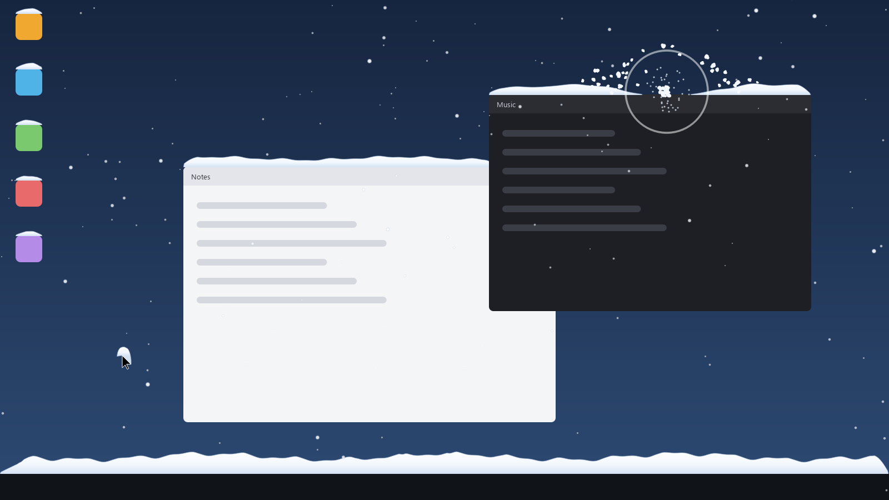

<p align="center">
  
</p>

<h1 align="center">Snowcat</h1>

<p align="center">Gentle, playful snowfall over your Windows desktop.</p>

<p align="center">
  
</p>

Snow falls over everything on your screen and **piles up on your windows, your desktop icons and the taskbar**. You can play with it: shake it off, melt it, blow it around, or throw snowballs at it. Clicks always go straight through to your apps, so you can keep working while it snows.

## Features

- **Snow that settles** on the tops of open windows, on desktop shortcut icons and along the taskbar, in soft, uneven drifts.
- **Shake a window** and its snow tumbles off in clumps that burst into powder when they land on the taskbar.
- **Hover over a pile** to clear a circle of snow around the mouse pointer.
- **Swipe the mouse fast** through the falling snow to blow the flakes around.
- **Snow hat:** leave the mouse still and snow slowly piles up on the pointer. Move it and the hat falls off.
- **Snowball slingshot:** pull back, aim and let go to fling a snowball that bursts and knocks snow flying.
- **Settings window** with sliders and switches for everything, saved between runs.
- Stays out of the way: it ignores full-screen games, hidden mouse pointers and click-through overlays.

## Requirements

- Windows 10 or 11
- [Python](https://www.python.org/downloads/) 3.10 or newer. When installing, tick **"Add python.exe to PATH"**.

## Install

1. Download Snowcat: click the green **Code** button at the top of this page, then **Download ZIP**, and unzip it.
   (Or with git: `git clone` this repository.)
2. Open PowerShell and type in the project folder:
   ```
   cd "$HOME\Downloads\SnowCat-main\SnowCat-main"
   ```
3. Install the two libraries it needs:
   ```
   pip install -r requirements.txt
   ```
4. Start it:
   ```
   python snowcat.py
   ```
5. Optional: add a Snowcat icon to your desktop, so next time you can just double-click it:
   ```
   python make_shortcut.py
   ```

## How to play

| Do this | And the snow... |
| --- | --- |
| Leave it running | piles up on windows, icons and the taskbar |
| Shake a window back and forth (or fling it) | falls off and tumbles onto the taskbar |
| Move the mouse onto a pile | clears in a circle around the pointer |
| Swipe the mouse quickly | gets blown around |
| Keep the mouse still for a few seconds | builds a little hat on the pointer |
| **Right-click and drag** anywhere, then let go | fires a snowball (pull back like a slingshot) |
| **Left-click and drag** on an empty part of the desktop | also fires a snowball |
| Close or maximize a snowy window | drops its snow |

A plain right-click (without dragging) still opens menus as normal.

## Settings

The Settings window opens when Snowcat starts. To bring it back, double-click the Snowcat icon in the system tray (click **^** next to the clock if you can't see it), or click the icon once and choose **Settings…**.

You can change how much snow falls, its speed and the wind, how quickly snow piles up and how deep it gets, how easy it is to shake off, and switch each fun feature on or off. Changes apply immediately and are saved to `settings.json`.

To stop Snowcat, click **Quit Snowcat** in Settings, or **Quit** in the tray menu.

## Good to know

- Snow appears on your main monitor only.
- Dragging on the desktop to fire a snowball still shows Windows' blue selection box underneath.
- In full-screen apps and games, Snowcat leaves the right mouse button alone (so right-click to aim still works).
- Snowcat runs one copy at a time. Starting it again just opens the Settings of the copy that's already running.

## How it works

Snowcat is a transparent, always-on-top window that lets every click fall through. Each frame it asks Windows where the windows, taskbar, icons and mouse are, then moves and draws the snow with [PyQt6](https://pypi.org/project/PyQt6/). [pywin32](https://pypi.org/project/pywin32/) and `ctypes` handle the Windows parts.

| File | What it does |
| --- | --- |
| `snowcat.py` | Starts everything |
| `overlay.py` | The see-through window, and the per-frame loop |
| `snowfall.py` | Falling flakes, mouse gusts and the snow magnet |
| `snowcover.py` | Settled snow: windows, taskbar, icons, shaking, clearing, clumps |
| `snowpile.py` | The shape of one pile of snow |
| `cursorsnow.py` | The snow hat on the mouse pointer |
| `snowballs.py` | The snowball slingshot |
| `mousehook.py` | Turns right-click drags into slingshot pulls |
| `desktopicons.py` | Finds the desktop icons |
| `win32_helpers.py` | Finding windows, the taskbar and the mouse |
| `settings.py`, `settings_window.py` | The settings and their window |
| `tray.py` | The tray icon, its menu and the logo |
| `make_shortcut.py` | Creates the desktop shortcut |

## License

[MIT](LICENSE): free to use, change and share.
